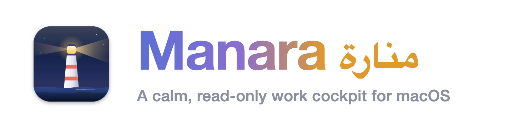

<p align="center"></p>

# Manara

*Manara* (منارة) is Arabic for "lighthouse": quiet in calm water, a single light when something needs you.

A calm, read-only work console for macOS, built for a tech lead.

It is one dashboard in its own full-screen Space, plus optional desktop widgets, a menu-bar status and a floating Quick Tools panel. It follows the **dark cockpit** rule from aircraft design: when everything is normal the screen is quiet, and only what needs you lights up — amber for "look soon", red for "act now". It never changes anything in the systems it watches; every action opens the real tool.

Why it exists: a tech lead's day is spread across health checks, pods, deploys, pull requests, issue trackers, ticket queues, chat mentions, the calendar and a standup. Checking each one is slow, and most of the time the answer is "nothing to do". Manara checks them for you and says, in one sentence, what deserves your attention right now.

```
┌───────────────────────────────────────────────────────────────────────────────────┐
│ API is down — Health check timed out.                 ● DB proxy  ↻ Refresh 09:42 │
│ Next: Refinement at 10:00, in 18 min  Join   Standup in 48 min   Sunday 18 October│
├──────────────────────────┬─────────────────────────────────┬──────────────────────┤
│ Systems  All|Back|Front  │ Your work            Focus|All  │ Today   Today|Standup│
│ ▌API             Down    │ Now                             │ Linear  closed 1     │
│  Health check timed out  │ ▌High Totals are wrong   Fix CI │ PRs     merged 2     │
│  [Investigate]           │  In Progress, ABC-12            │ 09:31 Merged  api #41│
│  Web app  #88     Normal │ Pull requests and other work    │ 09:05 Reviewed web #7│
│                          │ ▌Checkout fix      Address chgs │                      │
│ Tech issues      3 open  │ Reviews for you                 │ [Copy as standup     │
│ ▌Wrong total on page ●●● │ ▌Sara  2 PRs  oldest 2 days     │  draft]              │
│ Mentions and pings       │ Waiting to release              │                      │
│ ▌Omar wrote to you Reply │  api  4 commits on develop      │                      │
└──────────────────────────┴─────────────────────────────────┴──────────────────────┘
```

## Contents

- [A tour](#a-tour)
- [How attention is decided](#how-attention-is-decided)
- [Keyboard shortcuts](#keyboard-shortcuts)
- [Install](#install)
- [Configuration](#configuration)
- [Privacy and security](#privacy-and-security)
- [Architecture](#architecture)
- [Troubleshooting](#troubleshooting)
- [Development](#development)
- [Why not Übersicht](#why-not-übersicht)

## A tour

### The dashboard

Three resizable columns under a header. Drag a divider to resize (double-click resets); below about 76 rem the layout folds to two columns, then one. Everything scales with the text size (⌘+ / ⌘−).

**Header.** The **briefing** is one sentence: the most important thing right now, or "Nothing needs you right now." Under it: the meeting you are in or the next one (with **Join**), and the standup countdown. On the right: the clock, the date with "updated just now" (amber when nothing has arrived for 5 minutes), **Refresh**, the **DB proxy** chip, and buttons for Tools, Hide, Full screen / Window and Settings.

**Left column — what is happening**

| Section | What it shows |
|---|---|
| **Systems** | Tabs **All**, **Backends**, **Frontends** (a dot on a tab means something there needs a look). A healthy system is one quiet line: pods ready, last release and its PR. A system that needs a look expands: the reasons in plain words, pods (*9 of 9 ready, 1 new pod starting, no restarts today*), **Deploying now** while the deploy workflow runs, a release PR waiting to merge, and an **Investigate** button. Open Better Stack incidents are listed here too. |
| **Frontends and the live-build check** | A system with `"kind": "frontend"` and a `version` URL is checked for the build it actually serves (`/version.json` → `buildId`). If that is not the commit the last successful deploy shipped (20 minutes after the deploy, so a CDN refresh is not flagged) it turns Degraded: *Live site is not serving the last deploy*. |
| **Connections** | Appears only when something is wrong: an expired login with a **Sign in** button (also beside the briefing when the login is the headline, and on a system's "Pods unreadable" line), the DB proxy being off, or a reminder that your terminal's kubectl points at a production cluster. |
| **Technology issues** | Open cards in your ticket column (Basecamp). **You choose each one's colour**: every issue starts yellow, turns red only when you make it red (then it reaches the briefing, menu bar and notifications), and green means "not important for me". ✕ hides one. A plain reason sits under each title: *High priority and nobody has replied*, *Waiting on us for 5 hours*, *We replied 3 days ago — close it?*. Optionally, the error rate from an error-log chat room. |
| **Mentions and pings** | Only what is said **to you**: unread @mentions and private chats, with who wrote, an excerpt and **Reply**. |

**Middle column — your work**

| Section | What it shows |
|---|---|
| **Now** | Your top three Linear issues in the order you would pick them up: In Progress first, then priority, then most recently touched. Each says what its PR needs, or "no PR yet". |
| **Focus** | Workstreams: a PR, the Linear issues it closes and the Claude Code sessions that touched it, joined into **one row with one next action** — *Fix CI · Address changes · Reply · Read comments · Merge · Nudge · Request review · Open PR*. Two PRs that close the same issue are one row. Recently merged PRs keep their issues until release; an Urgent issue with no PR gets its own row; branches you pushed without a PR are listed. |
| **All issues** | Every open issue assigned to you, with inline filters (team, priority, status, project, text) that are remembered. |
| **Reviews for you** | PRs waiting for your review, grouped by teammate, team first, with the oldest wait. Click a teammate to expand. |
| **Waiting to release** | Repos whose `develop` is ahead of `main`, by how many commits and for how long (amber after 3 days). |

**Right column — the day**

**Today** is a live timeline of what you merged, opened and reviewed (reviews you submitted today), issues you closed, what you posted, meetings you attended and the Claude sessions you worked in, with a one-glance summary per source (meetings first: how many today, how many done, the one you are in and the next) and **Copy as standup draft**. The meeting you are in and the rest of today's meetings sit above the timeline, with their times; click one to join. Meetings come from macOS Calendar, so a Google calendar added in System Settings → Internet Accounts shows up here. During your standup window (default 09:00–11:00 on workdays) it switches by itself to **Standup**: your previous working day, written up as the list you read out (a plain headline, a short detail under it), with **Copy list** and **Enrich**. Tapping the other tab is a 10-minute peek.

**How the standup is written.** Manara keeps what the Today column is built from for every day (GitHub, Linear, Basecamp and your meetings; three weeks, in its cache). On a working day, from 05:00, the first refresh writes the standup for the previous working day up to yesterday — Sunday covers Thursday to Saturday. It starts from that record and fills in anything it missed (a day Manara wasn't running, a merge after the Mac slept) straight from the sources: GitHub, Linear and Basecamp searched over those days, the past week's meetings from macOS Calendar, and a digest of your Claude sessions (`scripts/standup-sessions.sh`: your prompts and the write-actions taken). `claude -p` turns it into the spoken list with `scripts/standup-prompt.md` as the writing rules: no tools, no MCP servers, and no saved session, so nothing new appears in your session list. It takes about 30 seconds, once a day; every other refresh reads it back. **Enrich** looks through the sources again and adds what the list is missing (a late merge, a meeting), keeping the items and wording you already have; before there is a list, **Write now** writes it. Nothing is written outside `~/Library/Caches/work-dashboard` (`days/`, `standup/`, `calendar-past.json`).

### Widgets

Optional small windows in the macOS widget sizes (small 158×158, medium 338×158, large 338×354) with the macOS widget look in every theme:

- **Calendar** — the day on a scrollable hour grid with a line at the current time, overlapping meetings side by side, **Join** shortly before a meeting, and ‹ › through the week.
- **What needs you** — the same alerts as the briefing, as many as fit. Click one to open it (a Better Stack incident or monitor opens its Better Stack page); a system or incident alert has **Investigate**.
- **Systems** — one tile per system; grey when normal, amber or red when not.

Each widget sits **on the desktop under your windows**, **always on top** or **like a normal window**, on **every desktop** or one. Move one with ⌥-drag, or use **Arrange widgets** to drag them all. Positions are remembered per widget and restored when a display comes back.

### Menu bar

A dot — red, amber, green (all clear) or grey (still checking) — and the count of things that need you. The menu lists up to eight of them and opens each one, plus Open Dashboard, Quick Tools, Arrange Widgets, Refresh Now and Settings. With Hide on, it shows only the count.

### Quick Tools

⌥⌘K opens a floating panel over whatever you are doing, without switching desktops. When it opens it reads the clipboard **once** and offers the tool that fits; when it closes it forgets the clipboard and what you typed. Everything runs inside the panel — nothing is sent or saved.

| Tool | What it does |
|---|---|
| JWT decoder | Header and payload, and when it expires — in your timezone. Flags millisecond `exp` values and encrypted (JWE) tokens. |
| Timestamp converter | Epoch seconds / ms / µs / ns or a date → your time, UTC, ISO 8601, Unix, and the Hijri (Umm al-Qura) date. A time without a zone is read in your configured timezone. |
| JSON formatter | Pretty, minified and sorted. Keeps numbers longer than 15 digits exactly. Converts Python dicts and Ruby hashes (`None`, `True`, `=>`, `:sym`, tuples, `Decimal(…)`, `datetime(…)`) to JSON. |
| Base64 | Encode and decode, URL-safe too, UTF-8-safe (Arabic). Binary results are shown as hex. |
| URL inspector | Host, path, query as JSON (a repeated key becomes a list), fragment, decoded and encoded forms; warns about credentials inside a URL. |
| Saudi phone | Any format (Arabic digits, 00966, 05…) → E.164; mobile prefix, landline area, unified and toll-free numbers. Optionally builds a dev-environment test phone from a user id. |
| Saudi IBAN, ID, VAT | IBAN mod-97 check and the bank's name, National ID / Iqama check digit, VAT number format. |
| Text inspector | Characters, code points, bytes, words, lines, SMS parts (GSM-7 or UCS-2), hidden characters (zero-width, bidi overrides, tag characters) and Arabic digits. |
| Hash & HMAC | SHA-1/256/512, HMAC-SHA256/512 with a text, `hex:` or `base64:` key, and a signature check (`sha256=…`, `v1=…`). |
| UUID / ULID | Generate v4, v7 and ULID; read the time inside a v1, v7 or ULID. |
| Case converter | snake_case, camelCase, PascalCase, kebab-case, CONSTANT_CASE, Title Case. |
| Lines → SQL IN | A pasted column → `('a', 'b')` or `(1, 2)`, a JSON array, sorted, unique, counted. Leading zeros keep a value as text. |
| Cron explainer | What a 5-field expression means and its next runs, in UTC (the Kubernetes default) and in your time. Explains Quartz syntax instead of guessing. |
| Text diff | Line-by-line comparison of two texts. |
| Jumps | Type or paste an issue key (`ABC-123`, for your configured teams) or `repo#123` to open it. |
| Find a Claude session | Searches what you typed in Claude Code sessions of the last 90 days; copy the resume command. |
| Database connections | Your proxy ports, which are listening, and a ready `psql` command that reads the password from Keychain without printing it. A port marked `never` has no copy button. |
| Copy standup list | The standup Manara wrote, ready to read out. |

Keys: type to search · ↑↓ choose · ↩ open · ⇥ into the tool · ⌘↩ copy the main result · esc back, then close.

### Themes and Liquid Glass

Settings → Appearance: **Graphite** (default), **Liquid Glass**, **Midnight** (true black), **Light**, or **Match macOS** (Light or Graphite with the system). Liquid Glass shows your desktop picture behind frosted cards; the app draws the picture itself, so it works in a full-screen Space too. Its kinds: **Smoked** (dark), **Clear** (thin, more of the picture), **Frosted** (light and milky, with dark text) and **Tinted** (smoked glass washed in Ocean, Aurora, Dusk, Ember or Rose). Themes change colours and surfaces only, never layout. Widgets keep the macOS widget look.

### Notifications

Only for things that need you, once per alert: a system going down (after two health runs agree), an open incident, an issue you marked red, an expired login, and a reminder N minutes before each meeting (with **Open** to join). When an alert ends it is forgotten, so a second outage notifies again. An incident's notification has **Investigate in Claude**.

### Incident investigation

A system that is not normal and every open incident has an **Investigate** button (also on the notification). One click writes the details on screen to a private file, opens Terminal in `incidents.cwd` and starts Claude Code with `incidents.command` (default `/incident-investigation`) and those details. The details are passed as one argument read from that file, never as shell code. The investigation is expected to be read-only; this app only starts it.

### DB proxy

If you use a local database proxy (the Cloud SQL Auth Proxy, `cloud-sql-proxy`), list its ports in `dbProxy.ports`. The chip beside Refresh is green when every `read` port is listening, amber with how many are down, and a red **Start DB proxy** when the proxy is off — one click runs your `dbProxy.startCommand` and checks again until the ports open. If your Google login expired, the chip says so and the click signs you in: your terminal opens and runs `gcloud auth login`, then `<startCommand>`, so all that is left is choosing your account in the browser. The chip shows "Signing in…" until the login is good and the ports open, then turns green. Hover lists every port.

## How attention is decided

The rules live in `web/core.js` (`alerts()`, `briefing()`, `workstreams()`, `reviewGroups()`, `dayTimeline()`) and in the collectors, so the dashboard, widgets, menu bar and notifications always agree.

- **Systems.** *Down* if a health URL fails or times out, no pod is ready, a pod is crash-looping or can't pull its image, or a Better Stack monitor is down. *Degraded* if a check inside the health response isn't ok (`{"database": "ok", "redis": false}`), the response takes over 3 s, a pod isn't ready after 10 minutes, a pod restarted in the last hour, the last deploy failed, or a frontend serves an old build.
- **No false alarms.** A system is announced as down only after two health runs in a row agree. *Degraded* during that system's own deploy shows as "while deploying" instead of an alert. Every health URL failing at once is treated as this Mac being offline, not every product going down.
- **Calm you can trust.** Until system health, GitHub and Linear have all answered, the briefing says "Still checking…", never "Nothing needs you". A source that fails, or goes quiet for three of its refresh intervals (at least 10 minutes), becomes an amber line: *GitHub data is 40 min old*.
- **Offline.** With no network the dashboard says so in one line and keeps showing the last data it had; logins are not reported as expired and systems are not marked down.
- **Technology issues** are yours to colour; only red ones interrupt you.
- **Reviews** turn amber after `reviewWaitHours.amber` (teammates only) and red after `reviewWaitHours.red`.
- **Your PRs** get one action each, in this order: failing CI or changes requested (red), open threads, new comments since your last push (amber), approved (merge), waiting on a reviewer (nudge after 3 days), no reviewer requested. Bots never count as a response.
- **Urgent issues.** An Urgent issue assigned to you with no PR yet is its own row and an amber alert, even before you start it.
- **Meetings** reach the briefing 10 minutes before they start.

## Keyboard shortcuts

| Keys | What |
|---|---|
| ⌃⌥⌘D | Bring the dashboard forward from anywhere |
| ⌥⌘K | Quick Tools from anywhere (⌘K inside the dashboard) |
| ⌃⌘F | Full screen ↔ a resizable window (remembered, with size and position) |
| ⌃→ / ⌃← | Swipe to and from the dashboard's Space |
| ⌘⇧R | Refresh all data now |
| ⌘R | Reload the pages |
| ⌘+ / ⌘− / ⌘0 | Text size: bigger, smaller, reset |
| ⌘⇧H | Hide: blur every title and name before you share your screen |
| j / k, ↩ | Move between rows and open one |
| ⌘, | Settings |
| ⌃⌥⌘E | Arrange widgets (drag them; again to finish) |
| ⌥-drag | Move one widget |

## Install

**Requirements**

| Needed | For |
|---|---|
| macOS 14 (Sonoma) or later | the app |
| Xcode command-line tools (`xcode-select --install`) | building it |
| `jq` | every collector |
| `gh`, signed in | GitHub: PRs, reviews, deploys, release radar, today's work |
| optional: `kubectl` (and `gcloud` for GKE) | pods |
| optional: the [`basecamp` CLI](https://github.com/basecamp/basecamp-cli), signed in | technology issues, mentions, posts |
| optional: a Linear personal API key in Keychain | Linear issues |
| optional: a Better Stack Uptime API token in Keychain | monitors and incidents |
| optional: Claude Code | sessions, session search, incident investigation |

```bash
git clone <this repo> ~/Developer/work-dashboard && cd ~/Developer/work-dashboard
./build.sh --login        # build into ~/Applications, and open at login and after every wake
open ~/Applications/Manara.app
```

On first launch the app copies `config.example.json` to `~/.config/work-dashboard/config.json` (mode `0600`). Edit it there, or use **Settings** (⌘,). macOS asks for **Calendar** (read-only: meetings and reminders) and **Notifications**.

Keys go into the Keychain with a command that asks for the value, so it never reaches your shell history:

```bash
security add-generic-password -s work-dashboard-linear -a token -w
security add-generic-password -s work-dashboard-betterstack -a token -w
```

`./build.sh` without `--login` builds only, and restarts the app if it is running.

## Configuration

`~/.config/work-dashboard/config.json` is yours and never in the repo (set `WD_CONFIG` to use another path). Every section is optional: a source you don't configure stays hidden. Changes apply as soon as the file is saved; only a change a collector reads triggers a refresh.

**You and your day**

| Key | Meaning |
|---|---|
| `me.name` | Your name as Basecamp shows it (left out of ping-room names). |
| `me.github` | Your GitHub login. |
| `me.basecampPersonId` | Your Basecamp **person** id — the `creator.id` on your recordings, not the Launchpad id that `basecamp me` returns. |
| `timezone` | IANA name, e.g. `Europe/Berlin`. Every "today" and every time shown uses it, so travelling never shifts a day. Default: this Mac's. |
| `textScale` | Base text size (1.0 = 100%); ⌘+ / ⌘− overrides it per Mac. |
| `workday.days` | Workdays, 0 = Sunday. Default `[0,1,2,3,4]`. |
| `workday.standup` | Standup time (`"09:30"`); a calendar event named "standup" wins. |
| `calendar.only` | The calendars to read meetings from, by calendar or account name as macOS Calendar shows it (e.g. `["you@company.com"]`); every calendar when unset. |
| `workday.standupPanelFrom`, `workday.standupPanelUntil` | When the right column shows the standup (default `09:00`–`11:00`). |
| `team[]` | `{name, github}`. Their PRs come first in Reviews and carry their names. |

**Sources**

| Key | Meaning |
|---|---|
| `github.org` | The organisation to search. Required for every GitHub section. |
| `github.releaseRadar[]` | Repos to compare `develop` ↔ `main`. |
| `github.reviewWaitHours` | `{amber, red}` in hours (default 24 / 72). |
| `linear.workspace` | Workspace slug, for issue links in Quick Tools. |
| `linear.keychainService` | Keychain service holding your Linear API key. |
| `basecamp.account` | Account id (for links). |
| `basecamp.issues` | `project`, `cardTable`, `columns[]` (column ids to watch), `teamProject` (whose people count as "us"), `label` (the section title); optional `titlePattern` (regex with a named group `p` for the priority word; the match is removed from the title) and `priorityLabels` (that word → `high` / `medium` / `low`). |
| `basecamp.errorChat` | Optional error-log chat: `project`, `room`, `match` (regex for lines that count), `groupPattern` (regex with group `t` naming the error), `lines` (how many to read, default 600), `label`. |
| `systems[]` | `name`, `detail`, `kind` (`backend` default, or `frontend`), `health[]` (`{url}`), `pods` (`context`, `namespace`, `prefix`), `deploy` (`repo`, `workflow` — a GitHub Actions workflow on `main`), `version` (a frontend's `/version.json` URL with `buildId`), `checkLabels` (a health-body key → plain words, e.g. `{"billing": "Can't reach the billing database"}`). |
| `betterstack.keychainService` | Keychain service holding a read-only Better Stack Uptime token. |
| `betterstack.team` | Optional Better Stack team id, for links to incidents and monitors. Default `0` (your current team once signed in). |
| `standup` | `model` (optional): the Claude model that writes the standup, e.g. `"sonnet"`; your default model when unset. |
| `claude.projectsDir` | Claude Code transcripts (default `~/.claude/projects`). |
| `claude.activeHours` | How far back sessions count (default 24). |
| `claude.issueKeys[]` | Issue-key prefixes that are yours, e.g. `["ABC", "XYZ"]`. Without them any `ABC-123` counts. |
| `claude.workRoots[]`, `claude.workWords[]` | Which sessions are work: run inside one of these folders, mention an issue key, or have a title with one of these words. Only work sessions appear in Today. |
| `dbProxy.ports[]` | `{port, name, role, db, user, keychain}`. `role`: `read` (counted by the chip, gets a psql command), `dev`, or `never` (accepts writes — no copy button). |
| `dbProxy.startCommand` | The command the **Start DB proxy** button runs (via `bash -c`, with `~/.local/bin` and Homebrew on `PATH`). |
| `dbProxy.log` | Your proxy's log file, named when it doesn't come up. |
| `dbProxy.keychainService`, `dbProxy.psql` | Keychain service for the database passwords (account = each port's `keychain`), and the `psql` path. |
| `devTestPhone` | Optional, for Quick Tools: `prefix` of your dev-environment test numbers, `fromUserId` (e.g. `"+9665550{id3}"`; `{id3}` is the id padded to 3 digits, `{id}` as typed), `note`. |
| `intervals` | Refresh seconds per collector (minimum 10). Defaults: `health` 60, `local` 60, `sessions` 120, `github` 180, `linear` 180, `basecamp` 300, `standup` 900, `today` 600. |

**The app**

| Key | Meaning |
|---|---|
| `dashboard.display` | `builtin` (default), `main` (the display with the menu bar) or a display's name as macOS shows it. A missing display falls back to the built-in one. Full screen vs window is remembered by the app (Settings → Opens as, or ⌃⌘F). |
| `appearance.theme` | `graphite`, `glass`, `midnight`, `light`, `system`. |
| `appearance.glass`, `appearance.tint` | Glass kind (`smoked`, `clear`, `frosted`, `tinted`) and the tint (`ocean`, `aurora`, `dusk`, `ember`, `rose`). |
| `widgets[]` | `id`, `type` (`meeting`, `alerts`, `systems`), `enabled`, `size` (`small`, `medium` default, `large`), `layer` (`desktop`, `floating`, `normal`), `allSpaces`. |
| `notifications` | `meetingMinutesBefore` (0 = off, default 5), `systemDown`, `newUrgentIssue`, `loginExpired` (all on by default). |
| `terminal` | The app that Investigate and Sign in open, as a path. Default iTerm2 when it is installed, else Terminal. |
| `incidents` | `cwd` (where Terminal opens, default `~`), `command` (default `/incident-investigation`), `claude` (default `~/.local/bin/claude`). `permissionMode`: how Claude runs — `auto` (default: it works without stopping for approval, and Claude Code's own check still blocks risky actions), `default` (asks at each step) or `bypassPermissions` (skips every check; Claude Code advises it only for sandboxes). |
| `showConnections` | `false` removes the Connections section (expired logins still reach the briefing). |
| `kubeProdReminder` | `false` hides the reminder shown while kubectl points at a production context (a context name containing "prod"). |

Keys that no longer exist (for example a widget's old `opacity`, `width` or `height`) are ignored, so an older config keeps working.

**Where things are kept**

| What | Where |
|---|---|
| Your config | `~/.config/work-dashboard/config.json` (`0600`) |
| Local choices: issue colours, hidden items, filters, column widths, text size, widget positions, alerts already notified | `~/Library/Application Support/Work Dashboard/state.json` |
| Full screen vs window, window frame | the app's user defaults |
| The last result of each collector, so a launch is instant | `~/Library/Caches/work-dashboard/` |

## Privacy and security

- **Read-only.** Collectors only list, get and search. The app writes nothing anywhere except its own config (from Settings), state and cache. Buttons open the real tool or copy a command for you to run; the only things the app starts are your own `dbProxy.startCommand` and, on Investigate, Terminal.
- **No server, no open port.** Pages talk to the app through a WebKit message bridge that answers only the app's own local pages (main frame, `file://` inside `web/`). Sensitive commands are allowed only from the page that needs them: the clipboard and session search from Quick Tools, writing the config from Settings, Investigate from the dashboard and the What needs you widget, the DB proxy and Sign in from the dashboard. Sign in runs only the fix the local collector built from your config, never text from the page.
- **No network from the pages.** Every page runs under a Content-Security-Policy with `connect-src 'none'`; all network calls happen in the collector scripts. Links open in your browser, and only `http(s)`, local documents and the macOS privacy settings pane are allowed.
- **Secrets stay in the Keychain.** Collectors read keys from it and pass them on stdin, never on a command line where `ps` would show them. The config holds only the names of Keychain items.
- **The clipboard** is read only when Quick Tools opens, never in the background, and forgotten when it closes. Anything a password manager marks as concealed or transient is skipped.
- **Hide** (⌘⇧H) blurs titles and names everywhere and keeps them out of the menu bar.

## Architecture

```
             ~/.config/work-dashboard/config.json
                            │
   scripts/*.sh, *.py ──────┤   one JSON object each, on their own timers
   (gh, kubectl, curl,      │
    basecamp, transcripts)  ▼
                    ┌───────────────┐      EventKit (Agenda.swift)
                    │  Store.swift  │◀──── calendar data, meeting reminders
                    │ config · state│
                    │ · last results│───▶ ~/Library/Caches/work-dashboard/*.json
                    └───────┬───────┘
                 broadcast  │  WD.receive(kind, name, payload)
                            ▼
                    ┌───────────────┐      bridge (Pages.swift): boot, state,
                    │  Pages.swift  │◀──── open, copy, notify, status, …
                    └───────┬───────┘      per-page allowlist
         ┌─────────────┬────┴─────────┬──────────────┐
   dashboard.html  widget.html   palette.html   settings.html
         └─────────────┴──── core.js ─┴──────────────┘
                (one set of judgements: alerts, briefing, workstreams…)
```

- **Collectors** (`scripts/`) each print one JSON object, even on failure (`{"error": "…"}`), so one broken source never blanks another. Offline, the network collectors exit with code 75 and the app keeps their last good result.
- **Store** owns the config, local state and the latest result of every collector. It runs each collector in its own process group with a timeout, caches results on disk, watches the config file, and refreshes on wake, when the network returns and when you switch to the app.
- **Pages** hosts the web views, pushes every change to every page, and answers the bridge.
- **core.js** holds every judgement call, so all surfaces agree. Pages only render.
- **Windows**, **Widgets**, **Backdrop**, **Agenda** and **Incidents** are the native parts: the dashboard window and Quick Tools panel, desktop widgets, the theme backdrop, Calendar and notifications, and the Terminal hand-off.

## Project layout

```
app/        Swift (AppKit, no Xcode project)
            main.swift       wiring, menus, wake and network triggers
            Store.swift      config, state, collectors, the process runner
            Pages.swift      web views and the bridge
            Windows.swift    dashboard window, Quick Tools panel, menu bar, global shortcuts
            Widgets.swift    desktop widgets
            Backdrop.swift   themes and the Liquid Glass backdrop
            Agenda.swift     Calendar (EventKit) and notifications
            Incidents.swift  Investigate → Terminal + Claude Code
            SelfTest.swift   Settings → Check the app (a pass/fail list)
            Info.plist
web/        theme.css (tokens + themes), core.js (shared logic), dashboard.html,
            widget.html, palette.html + tools.js (Quick Tools), settings.html
scripts/    collectors: health.sh local.sh github.sh linear.sh basecamp.sh today.sh
            standup.sh (+ standup-sessions.sh, standup-prompt.md) · sessions.py · search_sessions.py (Quick Tools) · lib.sh (helpers)
launchd/    open at login and after every wake (installed by ./build.sh --login)
tests/      node --test suites for core.js and tools.js
build.sh    builds Manara.app into ~/Applications
```

## Troubleshooting

| Symptom | What to do |
|---|---|
| "Your calendar hasn't synced since …", or meetings that aren't on your calendar | macOS Calendar's account stopped syncing and keeps repeating its old copy (Manara warns once nothing has changed for 10 days). System Settings → Internet Accounts → the account → sign in again; then Calendar → View → Refresh Calendars. |
| No meetings, "Allow calendar access" | System Settings → Privacy & Security → Calendars → turn on Manara. A rebuild changes the ad-hoc signature, so macOS may ask again. |
| No notifications | System Settings → Notifications → Manara → Allow. |
| A prompt about files in Documents or Desktop | The app reads `web/` and `scripts/` from the checkout, and collectors read the files you configure. Allow it under Privacy & Security → Files and Folders, or keep the checkout outside Documents and Desktop. |
| "No network — the dashboard is showing the last data it had" | Expected while offline; it clears by itself on the next refresh once the network is back. |
| "Google Cloud login expired", "GitHub signed out", "Basecamp signed out" | **Sign in** in Connections (or the red DB proxy chip): your terminal opens and runs the fix (`gcloud auth login`, `gh auth login`, `basecamp auth login`); finish in the browser. |
| "No Linear API key in Keychain" | Add it with `security add-generic-password -s <linear.keychainService> -a token -w`. |
| A section says its data couldn't be read | Run its collector by hand to see why: `scripts/github.sh | jq`. Collector failures are also logged as `WorkDashboard collector …` in Console.app. |
| Something seems off | Settings → **Check the app** → **Run self-test**: one line per check — each source's age and last error, the dashboard and widgets whole on one display, Keychain items (presence only), Calendar and Notifications permission, the Investigate and Sign in scripts (built in dry-run, never opened), the DB proxy command on `PATH`, hot reload, the menu bar item and shortcuts. It only looks; a widget it moves by 1 pt goes straight back. |
| A global shortcut does nothing | Another app has it; Console.app shows `shortcut … is taken by another app`. |
| It doesn't open at login | `./build.sh --login` again; the helper logs to `~/Library/Logs/work-dashboard-open.log`. |

## Development

- **Web changes reload by themselves.** Edit anything in `web/` and every open page reloads at once (the app watches the folder with FSEvents, no polling); no rebuild. Inspect a page with Safari → Develop → *your Mac* → the page.
- **Swift changes** need `./build.sh` (it restarts the running app). Type-check without building: `xcrun swiftc -typecheck -swift-version 5 -target $(uname -m)-apple-macos14 app/*.swift`.
- **Collectors** are plain scripts; run one alone to see its JSON: `scripts/health.sh | jq`. `WD_CONFIG=path` uses another config; `WD_DAY=2026-10-17 scripts/today.sh` replays a past day.
- **Tests** cover the shared logic and every Quick Tool, with no dependencies (Node 20 or later): `node --test`.
- **Self-test without clicking:** `touch ~/Library/Caches/work-dashboard/selftest-request` before the app starts; a minute after launch it writes `selftest-result.json` there and deletes the request.

**Adding a collector**

1. Write `scripts/<name>.sh` (or `.py`): source `lib.sh`, read your settings with `cfg '.your.key'`, and print **one** JSON object — `{"error": "…"}` on failure, with exit code 0. Call `keep_last_if_offline` first if its last result is still the best answer while offline. Stay read-only.
2. Add it to `collectors` in `app/Store.swift` with its default interval, and to `DEFAULT_EVERY` in `web/core.js`, then `./build.sh`.
3. Read it in a page as `WD.data.<name>`; put any judgement (is this red?) in `core.js`, not in the page.

## Why not Übersicht

This started as an Übersicht widget and was rebuilt as a native app to get away from these problems:

| Übersicht | Here |
|---|---|
| A local server (127.0.0.1:41416) runs shell commands for any local process that sends the right Origin header, plus a URL proxy on :41417 | No server, no port; a bridge locked to the app's own pages |
| Bundled Node 16 (end of life) | System WebKit and Swift |
| Widgets live on the wallpaper layer: under every window, on every Space or none | A full-screen Space for the dashboard; widgets choose desktop / on top / normal, and every Space or one |
| Per-display placement breaks after sleep or docking | Positions saved per widget, pulled back on screen when displays change and restored when they return |
| Timer-only refresh; refresh storms after wake | Refreshes on wake, when the network returns and when you switch to it, plus timers; starts instantly from cached data |
| Calendar access broken on recent macOS | EventKit with the current full-access permission |
| Permission prompts attributed to Übersicht | Its own identity and prompts |
| Absolute-pixel CSS | Responsive layout and a text-size control |
